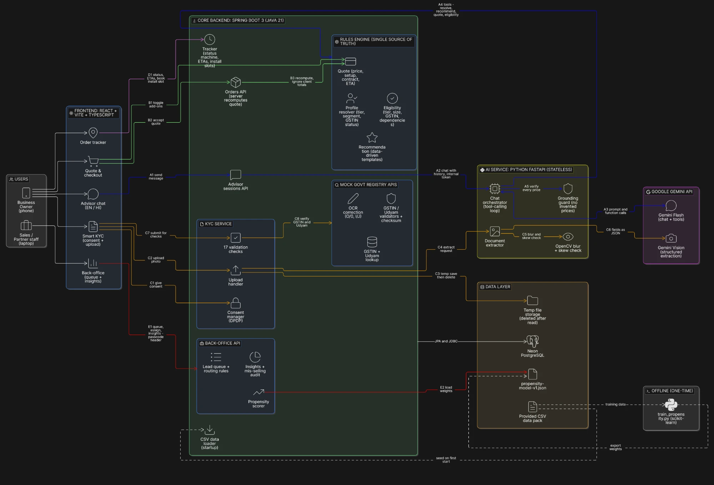
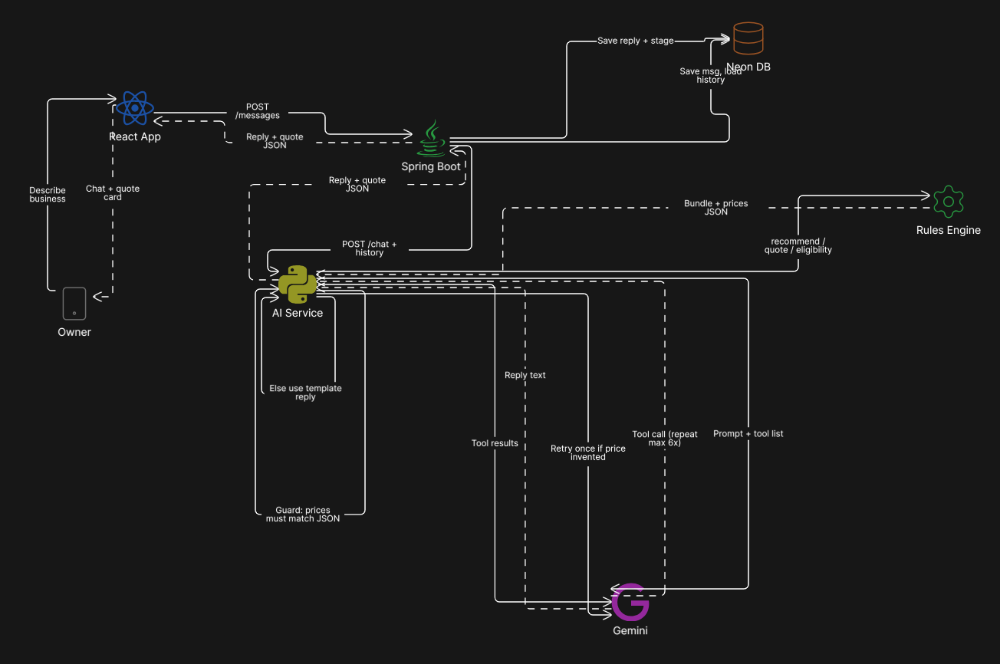
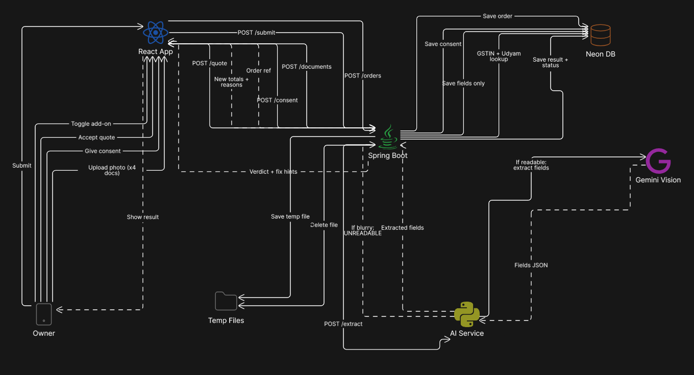
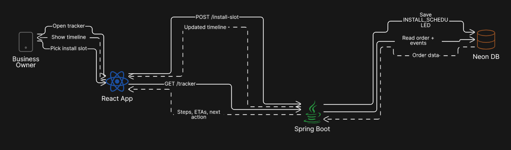

# Project Udyam Digital

A small business owner talks to an AI advisor on their phone, in English or Hindi, gets one clear monthly price, completes KYC by photo and tracks the order, without a sales visit.

Built by **team BlackHack** (Ayush Sahu and Chandrakant Gorain, NIT Jamshedpur) for the Accel YTL Hackathon 2026, Enterprise Track A. The case uses a fictional operator, Accel Telecom, and its B2B arm, Accel Business. All data is synthetic.

## What it does

| Module | What the owner or staff member gets | Route |
|---|---|---|
| **Advisor** | A chat that asks about the business and recommends a bundle from the catalogue, with a plain reason for each product | `/advisor` |
| **Quote and checkout** | One monthly price, add-ons to toggle, and products they can't buy listed with the reason | `/quote` |
| **Smart KYC** | Per-purpose consent, four document photos, 17 checks, and a specific fix hint for anything wrong | `/kyc/:orderId` |
| **Tracker** | Timeline, a date for each service and self-service install slots, instead of calling support | `/track`, `/track/:orderId` |
| **Back-office** | Leads the journey didn't close, with a score, reasons, a suggested channel, assignment and business insights | `/backoffice` |

**The AI never decides a product or a price.** Gemini gathers the facts and explains the result. A deterministic rules engine picks products, eligibility, quantities and prices. A guard checks every rupee amount and product in each reply against the engine's results, retries once if one doesn't match, then falls back to a template.

## Architecture



| Component | Responsibility |
|---|---|
| **Frontend** (React) | The customer journey and back-office. Talks only to Spring |
| **Backend** (Spring Boot) | Rules engine, orders, KYC checks, tracker, back-office and mock GST/Udyam registries |
| **AI service** (FastAPI) | Stateless. Runs the advisor's tool-calling loop and the guard, and handles document quality checks and extraction. The only part that holds the Gemini key |
| **Neon PostgreSQL** | Provided data, sessions, orders, consent, extracted fields and assignments |
| **Offline training** | `ai-service/ml/train_propensity.py` exports the model as JSON. Java scores leads with it, so no Python runs in the back-office path |

### Advisor flow



### Quote, checkout and KYC flow

Uploads go to a temp file only for the extraction call and are deleted straight after. Blurry photos are refused before any Gemini call.



### Tracker flow



## Tech stack

| Layer | Technology |
|---|---|
| Frontend | React 18, TypeScript, Vite 8, Tailwind CSS 4, react-i18next |
| Backend | Spring Boot 3.5, Java 21, Maven, Flyway |
| AI service | Python 3.12, FastAPI, google-genai, OpenCV |
| AI models | `gemini-3-flash-preview` (advisor), `gemini-3.1-flash-lite` (document reading) |
| Database | Neon serverless PostgreSQL (no Docker or local Postgres) |
| Propensity model | scikit-learn logistic regression, trained offline |

## Repository layout

```text
backend/      Spring Boot: rules engine, orders, KYC, tracker, back-office, mock registries
ai-service/   FastAPI: advisor, guard, document extraction; ml/ holds the training script and report
frontend/     React app: customer journey and /backoffice
data/         Provided CSVs and 47 specimen KYC images (synthetic)
docs/         Case study, HANDOFF.md (detailed build notes), architecture images
```

## Run it locally

### Prerequisites

- Java 21 and Maven 3.9+
- Python 3.12
- Node 24 and npm
- A [Neon](https://neon.tech) project. Use the **direct** connection host, without `-pooler`
- A [Google AI Studio](https://aistudio.google.com) API key
- Outbound TCP 5432 open. Some Wi-Fi networks block it; if the backend times out connecting, try a hotspot

### 1. Configure the backend

Copy `backend/src/main/resources/application-local.yml.example` to `application-local.yml` in the same folder. It's git-ignored. Fill it in like this:

```yaml
spring:
  datasource:
    url: jdbc:postgresql://<your-neon-host>/neondb?sslmode=require&reWriteBatchedInserts=true
    username: <your-neon-username>
    password: <your-neon-password>

app:
  ai-service:
    token: <shared-secret, same value as INTERNAL_TOKEN below>
  backoffice:
    key: <choose-a-passcode>      # without this, /backoffice stays locked
  demo-mode: true                 # optional: tracker demo controls
```

### 2. Configure the AI service

Copy `ai-service/.env.example` to `ai-service/.env` (also git-ignored) and set:

```text
GEMINI_API_KEY=<your-key>
INTERNAL_TOKEN=<the same shared secret>
```

### 3. Install dependencies (first time only)

From `ai-service/`:

```bash
python -m venv .venv
```

```powershell
.venv\Scripts\python -m pip install -r requirements.txt
```

macOS or Linux: `.venv/bin/python -m pip install -r requirements.txt`

From `frontend/`:

```bash
npm install
```

### 4. Start all three, each in its own terminal

**Backend first**, from `backend/`. The first start creates the schema and loads the CSVs into empty tables. Allow about a minute on a cold Neon database.

PowerShell:

```powershell
mvn spring-boot:run "-Dspring-boot.run.profiles=local"
```

bash:

```bash
mvn spring-boot:run -Dspring-boot.run.profiles=local
```

**AI service**, from `ai-service/`:

```powershell
.venv\Scripts\python -m uvicorn app.main:app --reload --port 8000
```

macOS or Linux: `.venv/bin/python -m uvicorn app.main:app --reload --port 8000`

**Frontend**, from `frontend/`:

```bash
npm run dev
```

### 5. Open it

| What | Where |
|---|---|
| Customer app | http://localhost:5173 |
| Back-office | http://localhost:5173/backoffice (enter your passcode) |
| Backend health | http://localhost:8080/actuator/health |
| AI service health | http://localhost:8000/health |

The browser only talks to the Vite server, which proxies `/api` to Spring.

## Try it

**Advisor.** Open the customer app, click **Talk to the advisor** and send:

```text
I run a kirana store in Ludhiana, 3 staff, one shop, no GST
```

**KYC.** Specimen documents are in `data/kyc_documents/`. Each applicant has its own expected verdict, listed in `backend/src/test/resources/kyc/expected-verdicts.json`. The order's GSTIN must match the applicant's documents, or the profile check fails. For example:

| Applicant | Expected result |
|---|---|
| K03 | Verified |
| K11 | Action required: address proof too old |
| K06 | Rejected |
| K04 | GST certificate too blurry to read |

**Tracker demo controls.** With `demo-mode: true`, open `/track/<orderId>?demo=1` to move an order forward or put it on hold. No field system is connected, so this is the only way an order moves past install scheduling.

## Tests

| Suite | Command | Run from | Passing |
|---|---|---|---|
| Backend (JUnit) | `mvn clean test` | `backend/` | 480 |
| AI service (pytest) | `.venv\Scripts\python -m pytest -q` | `ai-service/` | 146 |
| Frontend (Vitest) | `npm run test` | `frontend/` | 163 |

These need no database, network or Gemini key. The AI service tests use a fake model. Frontend build: `npm run build`.

Retrain the propensity model from `ai-service/`, after `pip install -r ml/requirements.txt`:

```bash
.venv/Scripts/python ml/train_propensity.py
```

Same seed, same metrics. On 5-fold cross-validation the AUC is 0.699, and the top 20% of leads by score hold 37.5% of activations. See [the model report](ai-service/ml/REPORT.md).

## Privacy and security

- **Consent:** KYC can't start without per-purpose consent, based on a versioned notice in English and Hindi. Withdrawing deletes the extracted data and check results.
- **Data minimisation:** raw images are never stored; only the extracted fields are kept.
- **Masking:** GSTIN, Udyam and ID numbers are masked in API responses and logs. Logs carry no chat text or extracted values.
- **Secrets:** kept in git-ignored files. Spring and the AI service authenticate with a shared token, and only the AI service holds the Gemini key.
- **External AI:** chat text, the business profile and document images go to the Google Gemini API.
